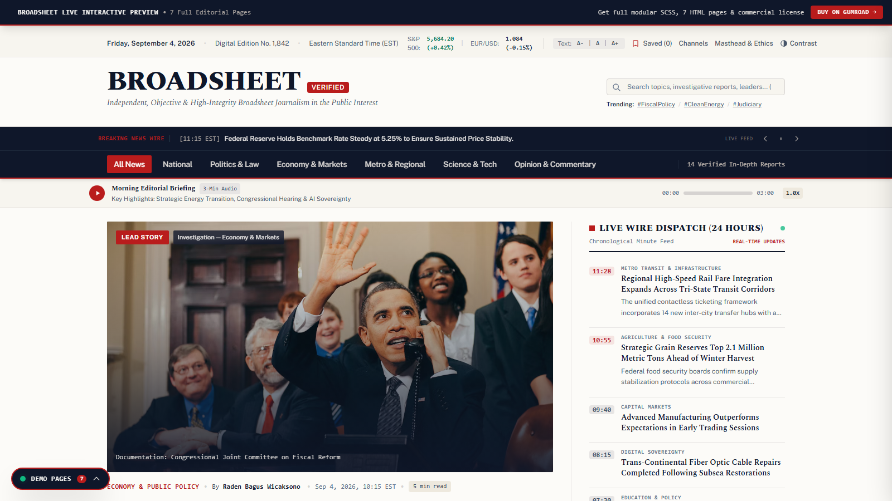

# Web Templates

A growing collection of production-ready website templates — landing pages, portfolios, dashboards, and more. Each template is hand-built, responsive, and easy to customize. No bloated frameworks, no page-builder lock-in.

**Browse & get templates:** coming soon · **Contact:** https://digikarya.gumroad.com

## Templates

| Template | Category | Preview | Status |
|----------|----------|---------|--------|
| [Broadsheet](broadsheet/) | News / Editorial |  | ✅ Available |
| _More templates are on the way_ | — | — | 🛠️ In progress |

> New templates drop regularly. Star this repo to get notified.

## Categories on the roadmap

- **Landing pages** — SaaS, product launch, waitlist, event
- **Portfolios** — developer, designer, photographer
- **Dashboards** — admin panels, analytics starters
- **E-commerce** — product pages, simple storefronts
- **Blog & docs** — personal blog, documentation sites

## What you get with each template

- Clean, readable source (HTML/CSS/JS or framework-based, noted per template)
- Fully responsive — mobile-first
- No jQuery-era baggage; modern tooling only
- Setup guide so you can deploy in minutes
- Personal-use license included; extended licenses available on request

## Request a template

Need something specific? Open an [issue](https://github.com/marzukiberg/web-templates/issues) with the category and a short description — popular requests get built first.

## License

Template sources are sold separately (see each template's page). This repository hosts the catalog and documentation.
