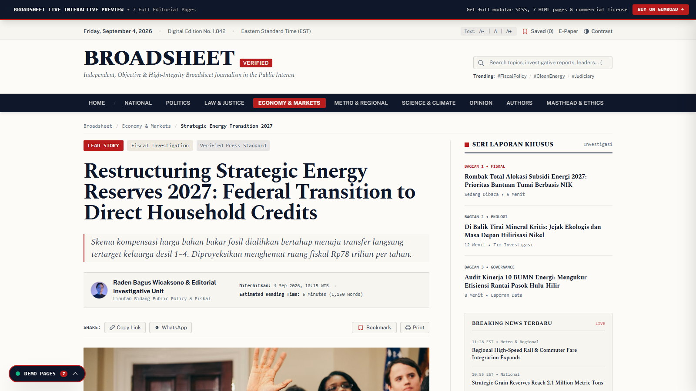

# Broadsheet — Modern Editorial & News HTML Template

An authoritative, high-performance HTML/CSS/JS template for modern digital journalism, investigative publications, and independent media houses. Classic broadsheet aesthetic, maximum reading comfort, zero-dependency client performance.

**Get the full template:** https://digikarya.gumroad.com/l/broadsheet-html-template


## Pages included (7)

| Page | What's inside |
|------|---------------|
| `index.html` | Homepage — hero bento showcase, breaking-news ticker, live wire feed |
| `detail.html` | Article page — reading progress bar, pull quotes, comment thread |
| `category.html` | Beat archives — sorting controls, numeric pagination |
| `author.html` | Journalist profile — press credentials, PGP fingerprint, work archive |
| `about.html` | Masthead — editorial board, ethics code, corrections form |
| `elements.html` | Design system — color tokens, typography scale, UI component kit |
| `404.html` | Custom error page with archive search |



## Features

- **Digital broadsheet typography** — Spectral serif display, Public Sans body, monospace timestamps; newsprint palette (paper `#fcfbf8`, carbon ink, press red)
- **Sticky category nav** with instant client-side story filtering
- **Live breaking-news ticker** — animated, with play/pause and prev/next controls
- **Reader utilities** — quick search (`Ctrl/⌘ + K`), saved-articles drawer (localStorage), font scaler (A−/A+), high-contrast mode
- **Audio brief player mockup** — 3-minute briefing with scrubber and speed controls
- **One-click share** — WhatsApp + copy-link with toast
- **Data journalism widgets** — interactive SVG bar chart with dataset filters, photo-essay showcase with EXIF metadata
- **Zero build step** — 100% static, deploy anywhere (Vercel, Netlify, Cloudflare Pages, GitHub Pages, Nginx)
- **Modular SCSS sources** included for deep customization

## Quick start

```bash
# 1. Get the template (one-time purchase)
#    https://digikarya.gumroad.com/l/broadsheet-html-template

# 2. Unzip and open — no build step needed
unzip broadsheet-template.zip && cd broadsheet-template
open index.html
# …or deploy the folder to any static host
```

Customize colors and fonts in `js/tailwind-config.js`, or recompile the SCSS:

```bash
npx sass scss/style.css css/style.css --style=compressed
```

## Tech

Vanilla HTML + Tailwind CSS + vanilla JS. No frameworks, no database, no build required.

## License

This repository contains documentation and screenshots only. The Broadsheet template source is sold separately — see [Gumroad](https://digikarya.gumroad.com/l/broadsheet-html-template) for license terms (commercial use allowed; redistribution of raw source prohibited).
